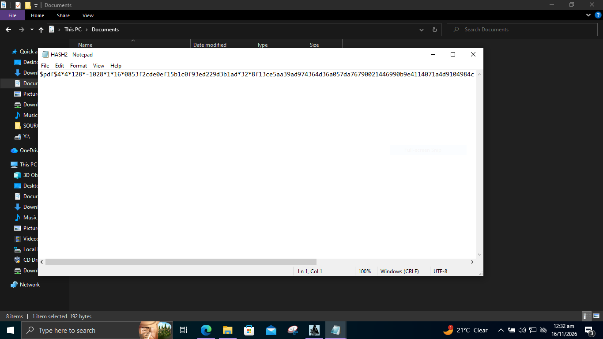
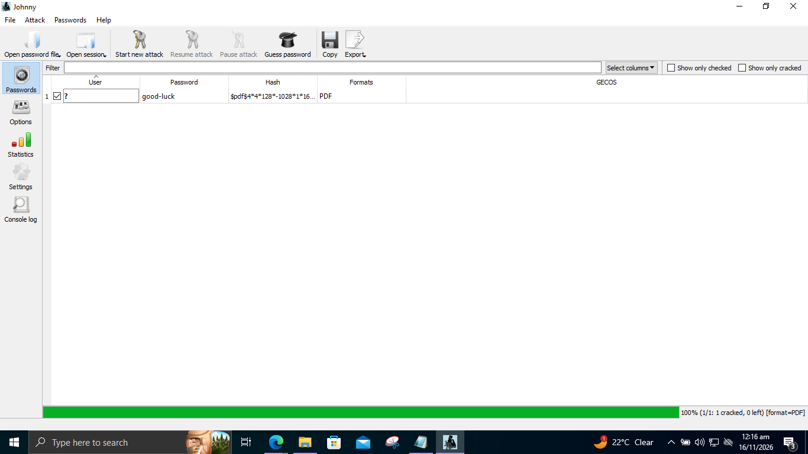
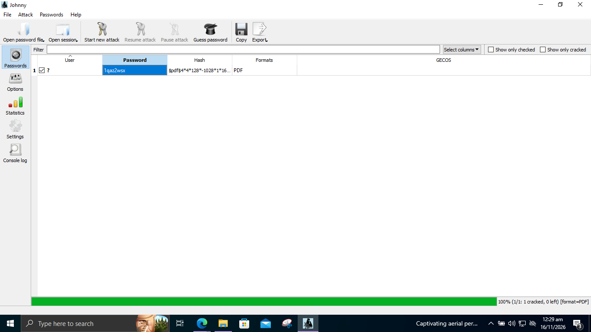
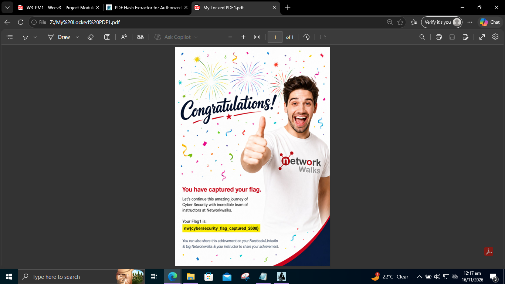
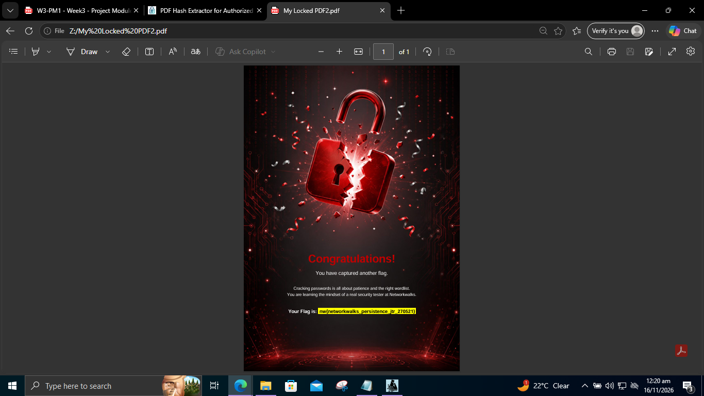
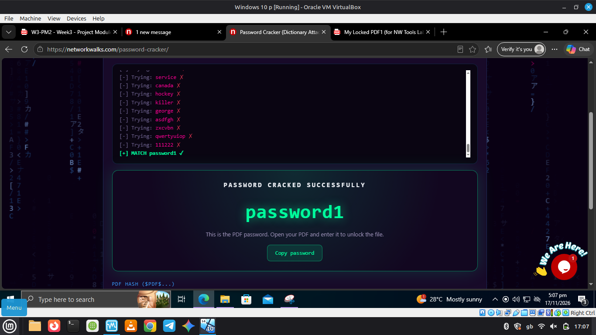

# netwalks-B0084H-week3
Password Cracking
# Week 3 | Password Cracking — JTR,
Johnny & NetworkWalks Tools
## Objective
Crack locked PDF files by extracting their
hashes and running dictionary attacks, to
demonstrate why weak passwords fail in
the real world.
## Tools Used
- John the Ripper (JTR) + Johnny GUI
- OnlineHashCrack PDF Hash Extractor
- NetworkWalks Hash Calculator +
Password Cracker
- Windows 10 VM in Oracle VirtualBox
## Project Module 1 — JTR John + Johnny
### Steps I Followed
1. Downloaded `My Locked PDF1.pdf`, `My
Locked PDF2.pdf`, `My Locked PDF3.pdf`2. Uploaded each PDF to OnlineHashCrack
PDF Hash Extractor to get its hash
3. Saved each hash as `hash1.txt`,
`hash2.txt`, `hash3.txt` in `$pdf$...` format
4. Opened Johnny > Open password file >
Loaded hash file
5. Clicked Start Attack
6. Johnny cracked 100% (1/1: 1 cracked, 0
left)
7. Opened each PDF with its cracked
password to verify
### Results — Module 1
| PDF File | Cracked Password | Status |
| --- | --- | --- |
| My Locked PDF1.pdf | password1 |
Cracked in Johnny |
| My Locked PDF2.pdf | good-luck |
Cracked in Johnny |
| My Locked PDF3.pdf | 1qa2wsx | Crackedin Johnny |
### Evidence — Module 1
**1. Hash Extraction**

> Extracted `$pdf$` hash from My Locked
PDF1.pdf using OnlineHashCrack.

> Extracted `$pdf$` hash from My Locked
PDF2.pdf.

> Extracted `$pdf$` hash from My Locked
PDF3.pdf.**2. Cracked in Johnny**

> Johnny result for PDF1: `password1` —
100% cracked.

> Johnny result for PDF2: `good-luck` —
100% cracked.

> Johnny result for PDF3: `1qa2wsx` —
100% cracked.
**3. Verification — PDFs Opened**
> PDF1 opened with `password1` —
Congratulations

> PDF2 opened with `good-luck` — Flag
page. 

> PDF3 opened with `1qa2wsx` — Flag
page. 
## Project Module 2 — NetworkWalks
Tools
### Steps I Followed
1. Uploaded locked PDF to NetworkWalks
Hash Calculator
2. Tool extracted a crackable `$pdf$` hash3. Copied hash into NetworkWalks
Password Cracker
4. Started dictionary attack
### Result — Module 2
| PDF File | Cracked Password | Status |
| --- | --- | --- |
| My Locked PDF1.pdf | password1 |
PASSWORD CRACKED SUCCESSFULLY |
### Evidence — Module 2

> NetworkWalks Password Cracker:
`PASSWORD CRACKED SUCCESSFULLY` —
`password1`
## Key TakeawayAll three passwords are weak, but in
different ways:
- `password1` — Common dictionary
password + 1 digit
- `good-luck` — Two dictionary words +
hyphen
- `1qa2wsx` — Keyboard pattern, left side
of keyboard
Attackers don't guess randomly. They try
dictionary words, common phrases, and
keyboard patterns first. That is why these
fell quickly.
A strong password should be 12+
characters, random, with uppercase,
lowercase, numbers, and symbols, and not
a dictionary word or keyboard pattern.
## Skills Learned- Hash extraction from PDF files
- `$pdf$` hash format
- John the Ripper + Johnny GUI
- Dictionary attack
- Password strength analysis
- Verification by opening decrypted files
